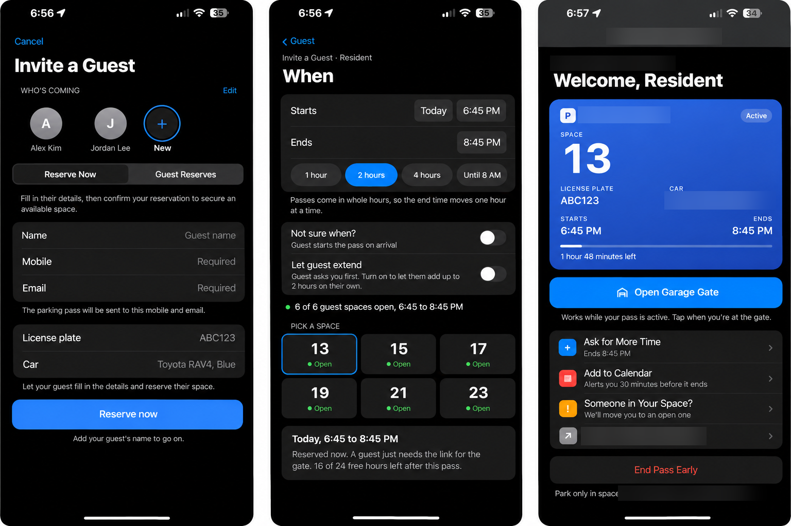

# Guest Parking: case study

> Case study only. The source code is private and is not in this repository.

**One line:** A guest-parking app for a 221-unit apartment building that gets a guest parked without the resident sharing a passcode, and gives everyone one clear rule when a guest space is taken. Reserving a guest spot is about 88% faster than on the building's existing system.

## Problem

At my apartment building in Los Angeles, getting a guest parked means three separate websites, a long form, and the resident's passcode, which the guest only finds out they need at the very end. A space can't be held until you know the guest's license plate. And when a guest arrives to find someone else in the guest space, nobody, not residents, guests or patrol, really knows what to do. The job to be done: *"My friend is coming over. Make sure they have a place to park."*

## What it does

- **Residents** invite a guest with a link, or approve a guest's request with one tap. They pick who and roughly when; the app picks a space and holds it.
- **Pending invites** in one view, so a resident can see which guests haven't used their invite yet.
- **Guests** get one page with the rules and price up front, then a pass with a live countdown and a one-tap extend.
- **A taken space gets fixed on the spot.** The guest taps "Someone's in my space", is moved to a free space, and can send a photo of the car in the way. Their host is told.
- **Patrol** types a plate and gets a clear green, yellow or red answer.

## Decisions I made, and why

| Decision | Why |
| --- | --- |
| No passcodes for guests: an invite link, or a one-tap approval by the resident | Guests hit the passcode wall last, and a shared passcode keeps getting passed around. |
| Ask only for what the host knows; the plate is optional and the guest adds it from their link | Hosts often don't know a friend's plate, and that shouldn't stop them holding a space. |
| The app picks and holds the space, and offers the next opening when a time is full | Show the answer, not the form. A suggestion beats an error. |
| Rules are the system's job | The app only offers what's allowed, so residents never have to read the rules. |
| One rule anyone can say out loud for a car in a guest space: one notice and a short time to move or get a pass, then patrol may tow | Most of those cars belong to welcome guests who skipped a clumsy process. The notice turns a tow into a pass, and everyone gets the same warning in writing first. |
| Start enforcement from a person, not a sensor | The lot has no sensors, so the app only knows who was promised a space. The guest who can't park, or patrol, starts every report. |
| Connect to the building's existing system read-only first, with real passes behind an off switch and paid passes always refused | I could test on my own apartment without risking anyone else's parking. |
| Private by default | Guest details never go in web links, and there's no third-party tracking. |
| Build from the iPhone's own patterns | It feels familiar on a phone without anyone having to learn it. |

**How it was built:** Claude wrote most of the code; I wrote specs, reviewed and tested every change. The product calls above were mine.

## Evidence

| Evidence | Type | What it changed |
| --- | --- | --- |
| What I saw as a resident: guests often park in guest spaces without a pass, and nobody knows what to do | Human research (my own observation, one person) | Led to the "taken space" flow and the one-notice rule. |
| Walkthrough of the building's current guest-parking site, public pages only | Desk research | Showed where guests get stuck: multiple sites, a hidden price, and the passcode at the end. |
| Simulated first-time users (impatient, skeptic, slow connection, non-native English reader, "breaker") run from the landing page to a guest holding a pass, over two rounds | AI persona testing (simulated, not users) | First round: none could reach a pass without a hidden link. That led to a new landing page and sign-in; the second round had no dead ends. |
| Automated tests and browser checks on made-up data, with real passes switched off | Simulated | Caught rule and wording problems before release. |
| AI code review on every change | AI review | Fixes to edge cases and to sign-in safety. |
| Feedback from residents using the live version | Human research (resident feedback) | Confirmed the taken-space flow (moving a guest to a free spot when someone is in theirs), and led to a pending-invites view. |
| Time to reserve a guest spot, timed by me on the building's existing system and on this app | Measured (my own timing, both apps) | About 88% faster to reserve in this app. |
| A logger of guest-space availability from the building's public data | Measured production | Collecting; no results published here. |

## Status

| Stage | What |
| --- | --- |
| Proposed | Real text messages and card payments, camera plate scanning, importing the resident list, automatic escalation from warnings to towing |
| Implemented | Working prototype end to end on demo data: guest page, invite links, booking ahead, pass page, patrol plate check, taken-space reports with photos, staff settings, and a pending-invites view added after resident feedback |
| Deployed (private) | A live version connected to my building's existing guest-parking system, used by other residents in the building; sign-in and sessions were hardened as it opened to more residents |
| Verified | Automated tests, browser checks and simulated-user rounds. Texts and payments are simulated, so real delivery isn't verified. |

## Out of scope / unknown

- Not publicly available. One building in Los Angeles.
- Building management has seen it; this is not an official product of the building or its parking vendor.
- Demand beyond one building is unproven.

Architecture and test approach available on request.
